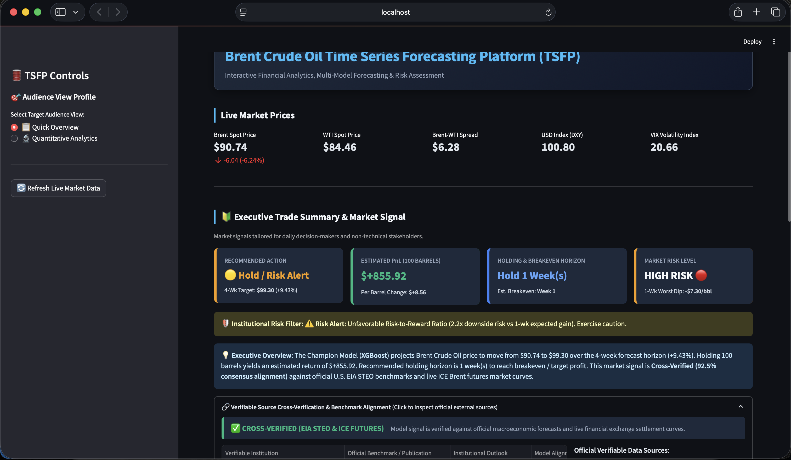
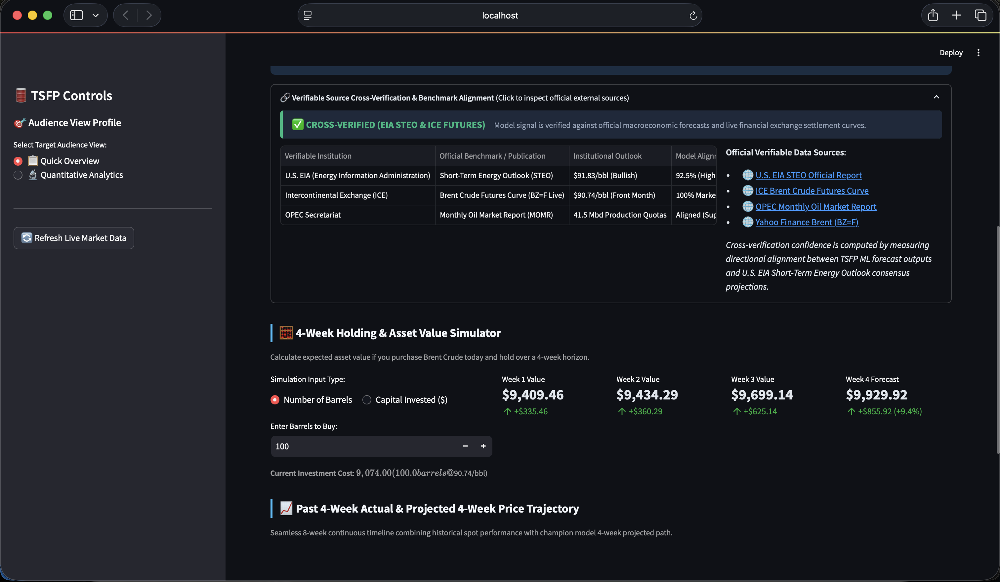
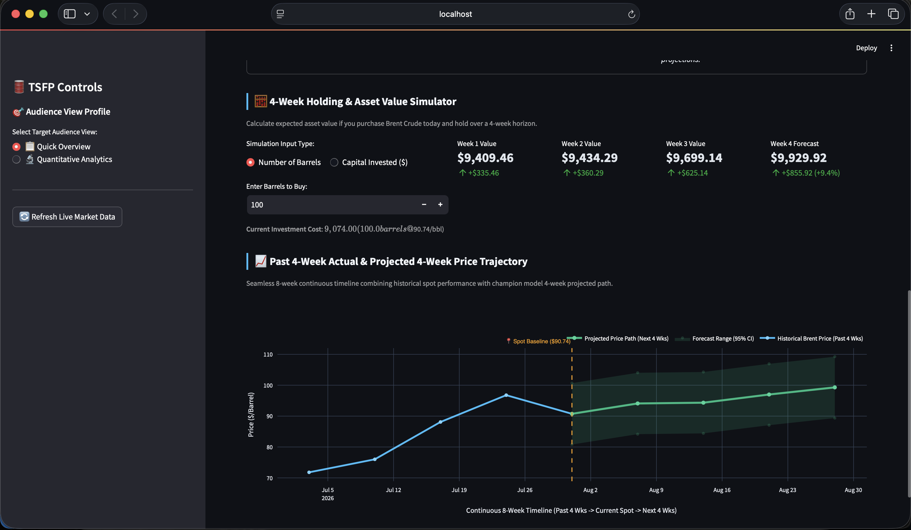
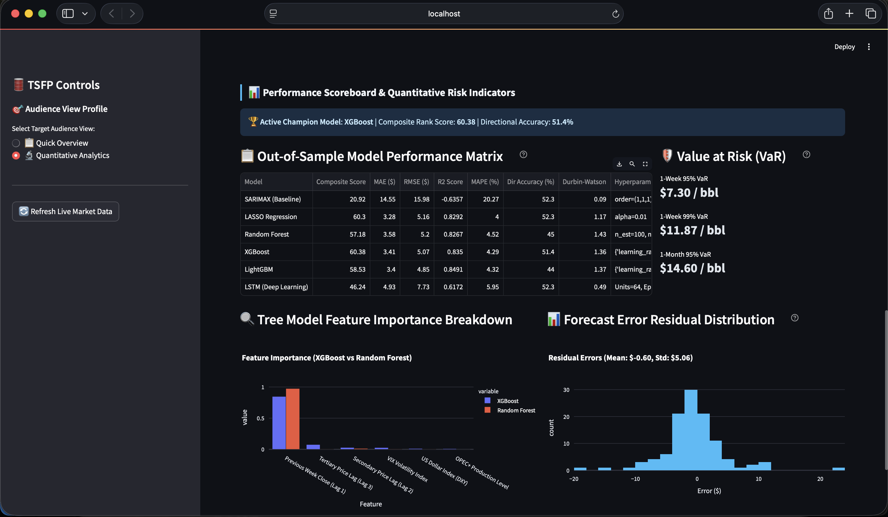

# 🛢️ TSFP – Brent Crude Oil Time Series Forecasting Platform

**Regime-Adaptive Time-Series Forecasting and Stress-Testing of Brent Crude Oil Prices**
*A comparative machine learning and econometric framework with an interactive Streamlit dashboard.*

MSc AI for Business Intelligence dissertation project · University of Leicester · Akil Mohamed Firos

---

## Table of Contents

1. [Overview](#overview)
2. [Dashboard Preview](#dashboard-preview)
3. [Key Features](#key-features)
4. [Research Questions & Key Findings](#research-questions--key-findings)
5. [Data](#data)
6. [Methodology](#methodology)
7. [Model Results](#model-results)
8. [Project Structure](#project-structure)
9. [Getting Started](#getting-started)
10. [Using the Dashboard](#using-the-dashboard)
11. [Notebooks](#notebooks)
12. [Limitations](#limitations)
13. [Disclaimer](#disclaimer)
14. [Dissertation & Documentation](#dissertation--documentation)
15. [Author & Acknowledgements](#author--acknowledgements)
16. [License](#license)

---

## Overview

Brent Crude Oil is the primary global pricing benchmark for energy markets, but it is
notoriously hard to forecast because of extreme volatility, regime shifts and non-linear
macroeconomic interactions.

The **Time-Series Forecast Platform (TSFP)** benchmarks six forecasting approaches on
weekly Brent data and turns the best-performing model into an interactive decision-support
dashboard:

| Paradigm | Model |
| :-- | :-- |
| Classical econometrics | SARIMAX (baseline) |
| Regularised linear | LASSO regression |
| Ensemble trees | Random Forest |
| Gradient boosting | XGBoost, LightGBM |
| Deep learning | LSTM (TensorFlow) |

Models are trained on engineered autoregressive price lags plus standardised macroeconomic
indicators (US Dollar Index, VIX, OPEC+ production), and compared on out-of-sample accuracy,
directional accuracy and residual diagnostics. The dashboard then produces a rolling
4-week forecast, a Value-at-Risk (VaR) assessment and a plain-language trade signal.

---

## Dashboard Preview

> Screenshots live in [`docs/screenshots/`](docs/screenshots/). Save your images there
> using the file names below and they will render automatically.

### Quick Overview – live prices, executive trade summary and market signal


### Source cross-verification panel & 4-week holding simulator


### Past 4-week actual vs. projected 4-week price trajectory (with 95% forecast range)


### Quantitative Analytics – model performance matrix, VaR, feature importance, residuals


---

## Key Features

The dashboard has two audience profiles, switchable from the sidebar.

**📋 Quick Overview** (for non-technical decision-makers)
- **Live market prices:** Brent spot, WTI spot, Brent–WTI spread, USD Index (DXY) and VIX.
- **Executive trade summary:** recommended action, estimated PnL, holding/breakeven horizon and a market-risk level (traffic light).
- **Institutional risk filter:** buy/sell signals are downgraded to *Hold / Risk Alert* when the downside VaR outweighs the expected gain, or when the champion model's directional accuracy is below 50%.
- **4-week holding & asset value simulator:** enter a number of barrels or a capital amount and see the projected value week by week.
- **Price trajectory chart:** 4 weeks of history joined to the 4-week champion-model forecast with a 95% range.

**🔬 Quantitative Analytics** (for analysts and risk managers)
- **Out-of-sample performance matrix:** MAE, RMSE, R², MAPE, directional accuracy, Durbin-Watson and a composite score for every model.
- **Value at Risk:** 1-week 95%, 1-week 99% and 1-month 95% VaR in $/bbl.
- **Feature importance:** XGBoost vs. Random Forest (and LightGBM).
- **Forecast residual distribution:** mean and standard deviation of errors.
- **Historical test chart:** filterable by year.
- **Macroeconomic what-if stress tester:** apply shocks to DXY (±20%), VIX (±50%) and OPEC+ production (±15%) and see the effect on the 4-week forecast.
- **"Why this price?" attribution:** dollar-level contribution of each feature to the forecast.
- **Champion model selection:** composite rank (default), highest directional accuracy, lowest RMSE, highest R², or manual choice.

---

## Research Questions & Key Findings

| | Question | Outcome (per the dissertation) |
| :-- | :-- | :-- |
| **RQ1** | Can gradient-boosted trees with engineered macro features beat SARIMAX and LSTM? | **Confirmed.** LightGBM reached R² = 0.849 and XGBoost the top composite score, against SARIMAX R² = −0.636 and LSTM R² = 0.617. |
| **RQ2** | How robust are modern-trained models when back-tested on the 2007–2015 crisis decade? | **Degradation confirmed.** MAE rose by roughly 28–30% (to about $4.4) and the Durbin-Watson statistic fell to about 0.45–0.50, indicating strongly autocorrelated errors. R² stayed above 0.92 on the historical era. |
| **RQ3** | Do exogenous macro Z-scores improve weekly directional accuracy? | **Marginally.** Top models reach 51–52% directional accuracy, only slightly above a coin flip. |

> See the full dissertation for the complete analysis, statistical caveats and hypothesis tests.

---

## Data

| Source | Series | Notes |
| :-- | :-- | :-- |
| Yahoo Finance (`yfinance`) | Brent `BZ=F`, WTI `CL=F`, US Dollar Index `DX-Y.NYB`, VIX `^VIX` | Daily data resampled to **weekly Friday closes** (`W-FRI`) |
| U.S. EIA API v2 (STEO) | OPEC+ crude production (`COPR_OPECPLUS`) | Monthly, forward-filled to weekly. Falls back to a constant of 41.5 Mbd if the API is unreachable |

- **Modern era:** 2016 → present (used for training and evaluation).
- **Historical regime era:** 2007–2015 (used for out-of-time stress testing; includes the 2008 financial crisis and the 2014 OPEC price war).
- Fetched data is cached to `data_processed/` so the app starts quickly. Use **🔄 Refresh Live Market Data** in the sidebar to force a re-fetch.

---

## Methodology

**Feature engineering** (`src/data_loader.py`)
- Log-transformed target (`Brent_Log`).
- 4-week SMA, EMA and rolling median.
- Z-score standardisation of WTI, USD Index, VIX and OPEC+ production.
- Autoregressive lags: `Price_Lag_1`, `Price_Lag_2`, `Price_Lag_3`.

**Model inputs.** The ML models use six features: three price lags plus `USD_Z`, `VIX_Z` and `OPEC_Z`.

**Training and evaluation** (`src/models_engine.py`)
- Chronological **80/20 train/test split** (no shuffling).
- XGBoost and LightGBM are tuned with `GridSearchCV` over a 5-fold `TimeSeriesSplit`.
- SARIMAX is fitted as `(1,1,1)` with a 52-week seasonal AR term.
- LSTM predictions come from the notebook run and are loaded from `data_processed/lstm_test_predictions.csv`.

**Composite score.** A single 0–100 ranking metric: 40% directional accuracy + 30% R² + 30% normalised RMSE.

**4-week forecast.** An iterative multi-step autoregressive forecast: each prediction is fed back in as the next step's lag.

**Risk engine.** Historical weekly-return percentiles give the 95% and 99% VaR. The 1-month VaR is the 1-week VaR scaled by √4.

---

## Model Results

Out-of-sample results on the modern-era test set (weekly data, chronological 80/20 split):

| Rank | Model | Composite | MAE ($) | RMSE ($) | R² | MAPE (%) | Dir. Acc. (%) | Durbin-Watson |
| :-: | :-- | :-: | :-: | :-: | :-: | :-: | :-: | :-: |
| 1 | **XGBoost** | **60.38** | 3.41 | 5.07 | 0.835 | 4.29 | 51.4 | 1.36 |
| 2 | LASSO | 60.30 | 3.28 | 5.16 | 0.829 | 4.00 | 52.3 | 1.17 |
| 3 | LightGBM | 58.53 | 3.40 | **4.85** | **0.849** | 4.32 | 44.0 | 1.37 |
| 4 | Random Forest | 57.18 | 3.58 | 5.20 | 0.827 | 4.52 | 45.0 | 1.43 |
| 5 | LSTM | 46.24 | 4.93 | 7.73 | 0.617 | 5.95 | 52.3 | 0.49 |
| 6 | SARIMAX (baseline) | 20.92 | 14.55 | 15.98 | −0.636 | 20.27 | 52.3 | 0.09 |

**Reading these results honestly**
- Boosted trees give the lowest price errors, but **directional accuracy is close to 50% for every model**. Treat the dashboard's signals as risk context, not as a trading edge.
- A very low Durbin-Watson (SARIMAX, LSTM) means errors are strongly autocorrelated, i.e. the model lags the market.
- Feature importance is dominated by the previous week's price (`Price_Lag_1`).
- LightGBM's directional accuracy is reported as 44.0% in the cross-era comparison table and in the dashboard, but as 46.8% in the main benchmark table of the dissertation. This README uses the dashboard value.

---

## Project Structure

```
TSFP - Brent Crude Oil/
├── app.py                      # Streamlit dashboard (entry point)
├── requirements.txt            # Python dependencies
├── src/
│   ├── data_loader.py          # Data ingestion, caching, feature engineering
│   └── models_engine.py        # Model training, metrics, forecasting, VaR, scenarios
├── notebook/
│   ├── data_collection_cleaning_EDA.ipynb
│   ├── sarimax_baseline.ipynb
│   ├── lstm_forecasting.ipynb
│   ├── xgboost_comparison.ipynb
│   ├── lightgbm_historical_validation.ipynb
│   └── master_ml_comparison.ipynb
├── data_raw/                   # Reserved for raw downloads (currently empty)
├── data_processed/
│   ├── master_dataset_cache.csv      # Cached modern-era master dataset
│   ├── master_dataset_2007_2016.csv  # Historical-regime dataset
│   └── lstm_test_predictions.csv     # Cached LSTM test-set predictions
├── dissertation/               # Dissertation report (Word)
├── presentations/              # Sprint and final presentation slides
└── docs/
    └── screenshots/            # Dashboard screenshots used in this README
```

---

## Getting Started

### Prerequisites
- Python 3.9 or newer
- Internet access for the first run (live market and EIA data). Cached CSVs in `data_processed/` are used afterwards.

### Installation

```bash
# 1. Clone the repository
git clone <your-repository-url>
cd "TSFP - Brent Crude Oil"

# 2. Create and activate a virtual environment
python3 -m venv .venv
source .venv/bin/activate          # Windows: .venv\Scripts\activate

# 3. Install dependencies
pip install -r requirements.txt
```

> **Note on the LSTM.** The dashboard does **not** need TensorFlow, because it loads cached LSTM predictions from CSV. To re-run `lstm_forecasting.ipynb` you will also need `tensorflow` (and `jupyter`), which are not in `requirements.txt`:
> ```bash
> pip install tensorflow jupyter
> ```

### Run the dashboard

```bash
streamlit run app.py
```

Then open the URL Streamlit prints (usually <http://localhost:8501>).

---

## Using the Dashboard

1. **Pick a view** in the sidebar: *Quick Overview* or *Quantitative Analytics*.
2. Read the **market signal** and risk level, then expand the **cross-verification** panel for source links.
3. Use the **holding simulator** to estimate the value of a position over four weeks.
4. Switch to **Quantitative Analytics** to inspect the model comparison, VaR, feature importance and residuals.
5. Open the **Macroeconomic What-If Stress Tester** to shock DXY, VIX or OPEC+ production and see how the forecast responds.
6. Click **🔄 Refresh Live Market Data** to clear the cache and pull the latest prices.

> **About the cross-verification panel.** The EIA STEO / ICE / OPEC panel is an *illustrative alignment indicator* derived from the model's own forecast direction. It is **not** a live feed of official EIA or ICE forecasts. The links point to the official sources for manual verification.

---

## Notebooks

Suggested reading and running order:

| # | Notebook | Purpose |
| :-: | :-- | :-- |
| 1 | `data_collection_cleaning_EDA.ipynb` | Data collection, cleaning, stationarity tests and exploratory analysis |
| 2 | `sarimax_baseline.ipynb` | Classical econometric baseline |
| 3 | `lstm_forecasting.ipynb` | Deep learning model; produces `lstm_test_predictions.csv` |
| 4 | `xgboost_comparison.ipynb` | XGBoost modelling and tuning |
| 5 | `lightgbm_historical_validation.ipynb` | LightGBM and out-of-time historical validation |
| 6 | `master_ml_comparison.ipynb` | Final side-by-side comparison of all models |

---

## Limitations

- **Tree models cannot extrapolate** beyond the price range seen in training, so extreme moves hit an artificial ceiling or floor.
- **Monthly OPEC+ data is forward-filled** to weekly, which introduces step-function artefacts.
- **Static 80/20 split.** The models do not retrain as regimes change.
- **Weekly resolution.** No intraday dynamics, and no explicit modelling of geopolitical events.
- **Near-coin-flip directional accuracy** for all models.
- **Crisis degradation.** Performance falls noticeably on the 2007–2015 stress period.
- **Offline fallbacks.** If the EIA API is unreachable, OPEC+ production defaults to a constant, which weakens that feature.

Proposed future work (from the dissertation): intraday tick-data ingestion, temporal Transformer architectures (Informer, Autoformer, PatchTST), and unstructured alternative data such as LLM news-sentiment scoring and satellite crude-inventory tracking.

---

## Disclaimer

This project was built for **academic research and educational purposes only**. Nothing here
is financial, investment or trading advice. Forecasts and signals are model outputs with
substantial uncertainty and should not be used to make real trading decisions.

---

## Dissertation & Documentation

- 📄 Full dissertation (Word): [`Brent Crude Oil Price TSFP dissertation.docx`](dissertation/Brent%20Crude%20Oil%20Price%20TSFP%20dissertation.docx)
- 🎞️ Presentations: [`presentations/`](presentations/), covering sprints 1–4 and the final presentation

---

## Author & Acknowledgements

**Akil Mohamed Firos**, MSc Artificial Intelligence for Business Intelligence, University of Leicester (School of Computing and Mathematics).

- Academic supervisor: Dr. Andrew Morozov
- Industrial supervisor: Cemre Yoldas

Thanks to my academic and industrial supervisors for their guidance, and to the open-source community behind
`scikit-learn`, `xgboost`, `lightgbm`, `statsmodels`, `tensorflow`, `yfinance`, `plotly` and
`streamlit`. Data provided by Yahoo Finance and the U.S. Energy Information Administration.

---

## License

Released for academic and educational use. Add a `LICENSE` file (for example MIT) to define
reuse terms before sharing the repository publicly.
